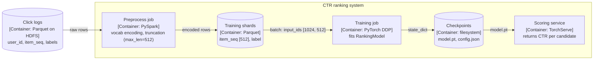
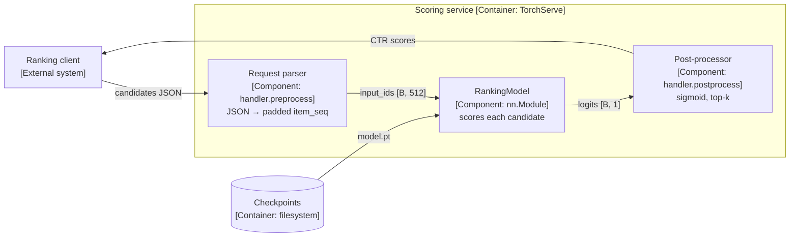

# Diagram Rules

## Contents
- Format table, common rules, Mermaid rules, C4 rules, draw.io rules
- D1. System diagrams: C4 container and component (required)
- D2. Data shape transition table (required)
- D3. Model forward pass diagram (required)
- D4. Structural pattern visualization (when applicable)
- D5. Model comparison table (required with 2+ models)
- D6. Checkpoint/output directory structure (required)

The final markdown document must include the diagrams below; a
partial analysis includes D1 plus only the diagrams of the sections
it keeps. Complex
ML pipelines are hard to understand from prose alone, so the diagrams
are a core deliverable. System diagrams, tables, and trees use formats
that render in common markdown viewers; model internals are draw.io
files the reader opens and rearranges:

| Content | Format |
|---------|--------|
| System and pipeline design (end-to-end, inference) | C4 container/component diagram, drawn as a Mermaid `flowchart` |
| Model internals (forward pass, skip connections) | draw.io file (`.drawio`), linked from the document |
| Shape transitions, model comparison | markdown table |
| Directory trees, attention-mask grids | code block |

Do not use ASCII box diagrams — in rendered markdown they read worse
than Mermaid and tables.

---

## Common rules

1. **Always annotate shapes**: every tensor in a diagram carries its
   shape in `[B, N, D]` form. A block without a shape is considered
   incomplete.
2. **Use concrete numbers**: prefer actual values read from the
   config (`512`, not `D`).
3. **Attach a legend**: when symbols or abbreviations are used,
   attach a legend below the diagram.
4. **Cite the code**: link the relevant code location below each
   diagram.

## Mermaid rules

- State the direction: `flowchart TD` or `flowchart LR`. A bare
  `graph` with no direction is forbidden because many renderers reject
  it or lay it out unpredictably.
- If a node or edge label contains brackets, parentheses, or braces
  (`[B, N, D]`, `Conv2d(3, 64)`), wrap the whole label in double
  quotes: `A["x [B, 3, 224, 224]"]`, `-->|"[B, N]"|`.
  Without quoting, Mermaid fails to parse.
- Group repeated blocks with `subgraph` and put the repeat count in
  the label: `subgraph BLK["TransformerBlock × 12"]`.
- Use `<br/>` for line breaks inside nodes.

## C4 rules

System and pipeline diagrams follow the C4 model at two levels, one
level per diagram:

- **Container**: every separately runnable or deployable unit and
  every data store — preprocessing job, training job, evaluation job,
  inference service, raw data store, checkpoint store, model registry.
- **Component**: the building blocks inside one container — Dataset,
  collate, model, loss, optimizer, checkpointer inside a training job;
  request parsing, model, post-processing inside an inference service.
  Layers inside the model sit below this level and belong to D3.

Draw them as Mermaid flowcharts:

- Each node label has three lines: name, `[Container: technology]` or
  `[Component: code unit]`, and what it is responsible for.
- A `subgraph` is the boundary: the system in a container diagram, the
  one container in a component diagram. Whatever lies outside it
  (upstream data, clients, neighbouring containers) stays outside the
  subgraph.
- Data stores use the cylinder shape: `DB[("...")]`.
- Label every edge with what crosses it — data format, artifact, or
  tensor shape.

## draw.io rules

Markdown viewers do not render draw.io files inline, so the document
links each file from the section it belongs to.

- One file per model: `<model>.drawio` in the diagram directory given
  in your prompt. Page 1 is the forward pass (D3); each structural
  pattern (D4) gets a page of its own (`<diagram name="...">`).
- Write uncompressed XML: `<mxfile>` → `<diagram>` → `<mxGraphModel>` →
  `<root>`, starting with `<mxCell id="0"/>` and
  `<mxCell id="1" parent="0"/>`.
- Every block is a vertex with an explicit `<mxGeometry>`. Lay blocks
  out on a regular grid so nothing overlaps.
- A repeated block is a container vertex with the repeat count in its
  label. Its children set `parent` to the container id and use
  coordinates relative to it.
- Every edge names its `source` and `target` cell ids.
- Labels are HTML: set `html=1` in the style, break lines with
  `&lt;br&gt;`, and XML-escape `&`, `<`, `>` and `"` inside `value`.

---

## D1. System diagrams: C4 container and component (required)

**Container diagram** — the top-level view of the whole system, from
data source to final output: which containers exist and what flows
between them.

Example (CTR ranking model):


**Component diagram** — the inside of one container, drawn by the
role that analyzes it (the inference container by inference-analyst).

Example (the scoring service above):


Adapt to the project's architecture — the examples above are only one
shape it can take.

---

## D2. Data shape transition table (required)

Summarize, as a markdown table, how one raw sample becomes a model
input batch. State how the shape changes at each stage.

Example (sequence):

| Field | Raw data | One Dataset sample | Batch (B=64) |
|-------|----------|--------------------|--------------|
| text | `"hello world"` (str) | `token_ids: [512]` int64, padded | `input_ids: [64, 512]` int64 |
| attn_mask | — | `[512]` bool | `[64, 512]` bool |
| label | `1` | `1` (int) | `labels: [64]` int64 |

Example (recsys/tabular):

| Field | Raw data | One Dataset sample | Batch (B=1024) |
|-------|----------|--------------------|----------------|
| item_seq | `[1029, 583, ...]` (variable length) | `[512]` int64, padded | `[1024, 512]` int64 |
| dense_feat | `{age: 0.3, ...}` | `[16]` float32 | `[1024, 16]` float32 |
| label | `clicked=1` | `1.0` (float) | `labels: [1024]` float32 |

Adapt to the project's data types.

---

## D3. Model forward pass diagram (required)

Draw how tensors flow inside the model, block by block, as page 1 of
the model's draw.io file. State the input/output shapes of each block.

Example (Transformer):
```xml
<mxfile>
  <diagram name="Forward pass">
    <mxGraphModel>
      <root>
        <mxCell id="0"/>
        <mxCell id="1" parent="0"/>
        <mxCell id="in" value="tokens [B, N]" style="rounded=1;whiteSpace=wrap;html=1;" vertex="1" parent="1">
          <mxGeometry x="140" y="20" width="240" height="40" as="geometry"/>
        </mxCell>
        <mxCell id="emb" value="Embedding(V=50k, D=512) + PosEmb&lt;br&gt;→ [B, N, 512]" style="rounded=1;whiteSpace=wrap;html=1;" vertex="1" parent="1">
          <mxGeometry x="140" y="100" width="240" height="50" as="geometry"/>
        </mxCell>
        <mxCell id="blk" value="TransformerBlock × 12" style="swimlane;whiteSpace=wrap;html=1;startSize=30;" vertex="1" parent="1">
          <mxGeometry x="100" y="190" width="320" height="230" as="geometry"/>
        </mxCell>
        <mxCell id="mha" value="LN → MHA(D=512, H=8)&lt;br&gt;Q,K,V: [B, 8, N, 64]&lt;br&gt;+ residual" style="rounded=1;whiteSpace=wrap;html=1;" vertex="1" parent="blk">
          <mxGeometry x="40" y="50" width="240" height="60" as="geometry"/>
        </mxCell>
        <mxCell id="ffn" value="LN → FFN(512→2048→512)&lt;br&gt;+ residual" style="rounded=1;whiteSpace=wrap;html=1;" vertex="1" parent="blk">
          <mxGeometry x="40" y="150" width="240" height="50" as="geometry"/>
        </mxCell>
        <mxCell id="out" value="LN → head [B, N, V]" style="rounded=1;whiteSpace=wrap;html=1;" vertex="1" parent="1">
          <mxGeometry x="140" y="460" width="240" height="40" as="geometry"/>
        </mxCell>
        <mxCell id="e1" style="edgeStyle=orthogonalEdgeStyle;html=1;" edge="1" parent="1" source="in" target="emb">
          <mxGeometry relative="1" as="geometry"/>
        </mxCell>
        <mxCell id="e2" style="edgeStyle=orthogonalEdgeStyle;html=1;" edge="1" parent="1" source="emb" target="blk">
          <mxGeometry relative="1" as="geometry"/>
        </mxCell>
        <mxCell id="e3" style="edgeStyle=orthogonalEdgeStyle;html=1;" edge="1" parent="blk" source="mha" target="ffn">
          <mxGeometry relative="1" as="geometry"/>
        </mxCell>
        <mxCell id="e4" style="edgeStyle=orthogonalEdgeStyle;html=1;" edge="1" parent="1" source="blk" target="out">
          <mxGeometry relative="1" as="geometry"/>
        </mxCell>
      </root>
    </mxGraphModel>
  </diagram>
</mxfile>
```

- State the parameter dimensions of every nn.Module submodule.
- Always mark reshape/transpose/permute/view points.
- State skip connections and residual paths.

Adapt to the project's architecture.

---

## D4. Structural pattern visualization (when applicable)

Visualize the architecture's key patterns. Not every project has
them; draw them when found in the code.

**Attention mask** (Transformer family):
a grid reads best as a code block.
Rows = Query, columns = Key, with a legend for the symbols.
```
         Pos 0  1  2  3  4
Pos 0  [  #   o  o  o  o ]
Pos 1  [  #   #  o  o  o ]
Pos 2  [  #   #  #  o  o ]
Pos 3  [  #   #  #  #  o ]
Pos 4  [  #   #  #  #  # ]
# = attend   o = masked   (causal mask)
```

**Skip connection paths** (ResNet, U-Net, ...):
add a page to the model's draw.io file that shows which layer connects
to which, with the shape on each block and the merge op (concat, add)
on each skip edge.

**Sharded embedding / communication patterns** (large-vocab
recsys/ranking models): when embedding tables are sharded across
ranks, add a page to the model's draw.io file that shows the shard
split and the all-reduce/all-to-all communication flow.

**Receptive field** (CNN family):
summarize the per-layer receptive field growth as a markdown table.

---

## D5. Model comparison table (required with 2+ models)

A markdown table that compares the key differences between models
at a glance. Focus on the differences actually found in the project.

Example:

| | Model A | Model B |
|---|---------|---------|
| Input shape | `[B, 3, 224, 224]` | `[B, 512]` |
| Parameters | 25.6M | 3.2M |
| Core block | ResBlock × 16 | TransformerBlock × 6 |
| Output shape | `[B, 1000]` | `[B, 1]` |
| Loss | CrossEntropy | BCE |

---

## D6. Checkpoint/output directory structure (required)

Write directory trees as code blocks.

```
/output/
+-- final/
|   +-- config.json
|   +-- model.pt (or model_state_dict.pt)
|   +-- optimizer.pt
+-- epoch_001/
+-- step_xxxxxx/
+-- logs/
    +-- tensorboard/
```
